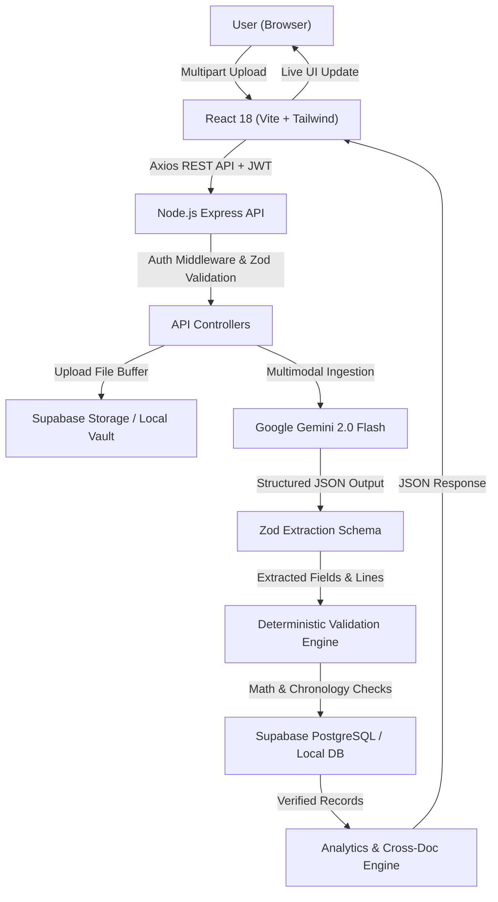

# LedgerLens AI — Intelligent Document Processing (IDP) Platform

> **"From Documents to Decisions — Powered by AI."**

[](https://opensource.org/licenses/MIT)
[](https://nodejs.org/)
[](https://react.dev/)
[](https://aistudio.google.com/)
[](https://supabase.com/)
[](https://tailwindcss.com/)

---

## 1. Project Overview

**LedgerLens AI** is an enterprise-grade Intelligent Document Processing (IDP) platform designed to eliminate repetitive manual financial audits, data entry, and vendor reconciliation. It automates the complete lifecycle of business documents:

1. **Document Ingestion**: Multi-file, drag-and-drop ingestion of PDFs, PNGs, and JPEGs with client-side and server-side MIME and size validation.
2. **Document Classification**: Automatic structural identification of **Invoices**, **Purchase Orders**, **Receipts**, and other commercial records based on content rather than filenames.
3. **Structured Information Extraction**: Extraction of financial totals, dates, vendor metadata, line items, and payment terms using **Google Gemini 2.0 AI**, validated through strict **Zod** schemas.
4. **Deterministic Math Validation**: Programmatic validation engine (`Subtotal + Tax - Discount = Total Amount`), line-item quantity/pricing cross-checks, date chronology enforcement, and duplicate invoice detection.
5. **Cross-Document Intelligence**: Automated 3-way matching and reconciliation between Invoices and Purchase Orders, highlighting price variances, unbilled items, and vendor name discrepancies.
6. **Knowledge Discovery & AI Insights**: Natural language query engine grounded strictly in verified database records, paired with executive spend reports and 1-click CSV exports.

---

## 2. Problem Statement & Proposed Solution

### The Problem
Organizations handle thousands of invoices, receipts, and purchase orders monthly. Manual processing leads to:
- **Financial Leakage**: Arithmetic miscalculations and subtle over-billing go unnoticed.
- **PO Discrepancies**: Invoices deviate from authorized purchase orders in unit prices and quantities.
- **Auditing Bottlenecks**: Manual document verification consumes hundreds of accounting hours.
- **Hallucination Risk**: Unconstrained LLMs often hallucinate financial calculations or introduce rounding errors.

### The Proposed Solution
LedgerLens AI pairs **Google Gemini AI's** multimodal understanding with a **deterministic JavaScript validation engine**:
- Gemini reads, classifies, and transcribes the visual document into structured JSON.
- Deterministic rules verify all arithmetic sums, tax rates, and date chronologies with strict tolerance thresholds.
- Financial decisions are grounded in real, verifiable database records with zero hallucinated figures.

---

## 3. UI/UX Design System

The visual identity of LedgerLens AI is inspired by modern luxury SaaS design:
- **Palette**: Monochromatic luxury neo-minimalism — soft light-gray canvas (`#F0F0F3`), crisp white floating cards with subtle drop shadows (`#FFFFFF`), and deep obsidian black contrast panels (`#111113`).
- **Interactive Controls**: Pill-shaped time-range selectors (`Day`, `Week`, `Month`, `Year`), rounded search pill inputs, and soft badge chips.
- **Visual Consistency**: Identical design language across Login, Registration, Password Recovery, Dashboard, Document Viewer, and Validation Center.
- **Split-Screen Workspace**: Side-by-side document auditor with responsive document zoom/pan on the left and structured extracted fields, line items, and audit controls on the right.

---

## 4. Tech Stack

| Layer | Technologies |
|---|---|
| **Frontend** | React 18, Vite 6, Tailwind CSS, React Router v6, Recharts, Lucide React, Axios |
| **Backend** | Node.js (ESM), Express.js, Multer, bcryptjs, jsonwebtoken, Zod, Helmet, Morgan |
| **AI Engine** | Google Gemini 2.0 Flash (`@google/generative-ai`), Multimodal Document Understanding |
| **Database & Storage** | Supabase PostgreSQL, Supabase Storage (with persistent local fallback store) |
| **Testing** | Node.js Test Suite (`node backend/tests/api.test.js`) |

---

## 5. Architecture & Data Flow



---

## 6. Folder Structure

```
ledgerlens-ai/
├── backend/
│   ├── sample_data/               # Standardized sample PDFs for instant demo testing
│   │   ├── sample_invoice_valid.pdf
│   │   ├── sample_purchase_order.pdf
│   │   ├── sample_invoice_discrepancy.pdf
│   │   └── sample_receipt.pdf
│   ├── src/
│   │   ├── config/
│   │   │   ├── env.js             # Environment validation and configuration
│   │   │   ├── supabase.js        # Supabase PostgreSQL & Storage client
│   │   │   └── gemini.js          # Google Generative AI client
│   │   ├── controllers/
│   │   │   ├── auth.controller.js
│   │   │   ├── document.controller.js
│   │   │   ├── validation.controller.js
│   │   │   ├── comparison.controller.js
│   │   │   ├── analytics.controller.js
│   │   │   ├── insights.controller.js
│   │   │   └── settings.controller.js
│   │   ├── middleware/
│   │   │   ├── auth.middleware.js # JWT Bearer token authentication
│   │   │   ├── upload.middleware.js # Multer file upload & MIME validation
│   │   │   └── error.middleware.js  # Centralized error handler
│   │   ├── routes/                # Modular REST route definitions
│   │   ├── services/
│   │   │   ├── gemini.service.js  # AI classification, extraction, Q&A
│   │   │   ├── document.service.js# Document lifecycle orchestration
│   │   │   ├── validation.service.js # Deterministic arithmetic engine
│   │   │   ├── comparison.service.js # Cross-document reconciliation
│   │   │   └── analytics.service.js  # Aggregate metrics & KPIs
│   │   ├── storage/
│   │   │   ├── db.js              # Repository layer (Supabase + local persistent fallback)
│   │   │   └── fileStorage.js     # Storage layer (Supabase Storage + local vault)
│   │   ├── utils/
│   │   │   ├── calculations.js    # Subtotal + Tax - Discount = Total checks
│   │   │   ├── response.js        # Standardized API response wrappers
│   │   │   └── errorHandler.js    # Operational AppError class
│   │   ├── validators/            # Zod validation schemas
│   │   ├── app.js                 # Express application configuration
│   │   └── server.js              # Server entry point
│   ├── migrations/
│   │   └── 001_initial_schema.sql # Complete Supabase PostgreSQL schema
│   ├── tests/
│   │   └── api.test.js            # Automated integration test suite
│   ├── .env.example
│   └── package.json
├── frontend/
│   ├── src/
│   │   ├── components/
│   │   │   ├── common/            # Card, Button, Badge, Modal, EmptyState
│   │   │   └── layout/            # Sidebar, Header, AppLayout
│   │   ├── context/
│   │   │   ├── AuthContext.jsx    # Session & user state
│   │   │   └── ToastContext.jsx   # Floating toast notification system
│   │   ├── pages/
│   │   │   ├── Login.jsx
│   │   │   ├── Register.jsx
│   │   │   ├── ForgotPassword.jsx
│   │   │   ├── Dashboard.jsx
│   │   │   ├── Documents.jsx
│   │   │   ├── DocumentUpload.jsx
│   │   │   ├── DocumentDetails.jsx
│   │   │   ├── ValidationCenter.jsx
│   │   │   ├── CrossDocumentAnalysis.jsx
│   │   │   ├── AIInsights.jsx
│   │   │   ├── Settings.jsx
│   │   │   └── NotFound.jsx
│   │   ├── services/              # API clients for all backend endpoints
│   │   ├── utils/                 # Currency, date, and status formatters
│   │   ├── App.jsx
│   │   ├── index.css
│   │   └── main.jsx
│   ├── .env.example
│   ├── package.json
│   ├── tailwind.config.js
│   └── vite.config.js
├── README.md
└── .gitignore
```

---

## 7. Database Schema (Supabase PostgreSQL)

The database schema is defined in `backend/migrations/001_initial_schema.sql` and includes:

1. **`users`**: User identities, hashed passwords (`bcrypt`), and registration timestamps.
2. **`documents`**: Document metadata, storage paths, MIME types, processing status (`Uploaded`, `Processing`, `Processed`, `Review Required`, `Failed`), and validation status (`Valid`, `Warning`, `Critical Issue`, `Review Required`).
3. **`extracted_data`**: Structured financial fields (vendor, customer, dates, subtotal, tax, discount, total amount, currency, confidence, source JSON).
4. **`line_items`**: Line item descriptions, quantities, unit prices, taxes, and totals.
5. **`validation_issues`**: Programmatic issue findings, severity, field name, extracted vs expected values, and resolution status.
6. **`document_matches`**: Cross-document reconciliation reports between Invoices and Purchase Orders.
7. **`document_reviews`**: Audit trail of manual human approvals, edits, and rejections.
8. **`refresh_tokens`**: Secure persistent authentication refresh tokens.

---

## 8. Installation & Local Setup

### Prerequisites
- Node.js v18 or higher (v20+ recommended)
- npm or yarn

### 1. Clone & Install Dependencies
```bash
# Clone the repository
git clone https://github.com/your-username/ledgerlens-ai.git
cd ledgerlens-ai

# Install backend dependencies
cd backend
npm install

# Install frontend dependencies
cd ../frontend
npm install
```

### 2. Configure Environment Variables

**Backend (`backend/.env`):**
```env
PORT=5000
NODE_ENV=development
FRONTEND_URL=http://localhost:5173

# Supabase (Leave empty for local persistent SQLite/JSON mode, or paste your Supabase keys)
SUPABASE_URL=https://your-project.supabase.co
SUPABASE_ANON_KEY=your-supabase-anon-key
SUPABASE_SERVICE_ROLE_KEY=your-supabase-service-role-key
STORAGE_BUCKET=documents

# Google Gemini AI (Obtain from https://aistudio.google.com/)
GEMINI_API_KEY=your_gemini_api_key_here
GEMINI_MODEL=gemini-2.0-flash

# JWT Authentication
JWT_SECRET=super_secret_jwt_access_key_32_characters_min
JWT_REFRESH_SECRET=super_secret_jwt_refresh_key_32_characters_min
JWT_ACCESS_EXPIRES_IN=1h
JWT_REFRESH_EXPIRES_IN=7d
MAX_FILE_SIZE_MB=15
```

**Frontend (`frontend/.env`):**
```env
VITE_API_BASE_URL=http://localhost:5000/api
```

### 3. Run the Application

In terminal 1 (Backend API):
```bash
cd backend
npm run dev
# Server runs at http://localhost:5000
```

In terminal 2 (Frontend Web App):
```bash
cd frontend
npm run dev
# Vite runs at http://localhost:5173
```

---

## 9. Automated Testing

Run the full end-to-end integration test suite:
```bash
cd backend
node tests/api.test.js
```

The test suite validates:
- Health check endpoint
- User registration and JWT generation
- User login & password verification
- Rejection of invalid credentials
- Ingestion and classification of Invoices and Purchase Orders
- Discrepancy detection in arithmetic and due dates
- Validation Center issue aggregation
- Cross-document invoice-to-PO 3-way matching
- Database-grounded natural language Q&A
- Dashboard aggregated analytics calculation

---

## 10. API Endpoint Reference

### Authentication
- `POST /api/auth/register` — Register a new account
- `POST /api/auth/login` — Sign in and receive access & refresh tokens
- `POST /api/auth/logout` — Revoke active session
- `POST /api/auth/refresh` — Refresh expired access token
- `POST /api/auth/forgot-password` — Request password reset
- `POST /api/auth/reset-password` — Complete password reset
- `GET /api/auth/me` — Get authenticated user profile

### Documents
- `POST /api/documents` — Upload and process a single document (Multipart)
- `POST /api/documents/batch` — Upload multiple documents
- `GET /api/documents` — Search, filter, and paginate user documents
- `GET /api/documents/:id` — Get document details, line items, and audit findings
- `GET /api/documents/:id/file` — Stream document file for preview
- `POST /api/documents/:id/process` — Reprocess document with Gemini AI
- `PATCH /api/documents/:id` — Update extracted fields manually
- `DELETE /api/documents/:id` — Permanently delete document and cascading records

### Validation Center
- `GET /api/validation` — List open validation anomaly alerts
- `GET /api/validation/:id` — Get validation issues for a single document
- `POST /api/validation/:id/review` — Record audit action (`Approve`, `Edit`, `Reject`)
- `PATCH /api/validation/issue/:id` — Update issue status (`Resolved`, `Dismissed`)

### Cross-Document Intelligence
- `POST /api/comparisons` — Compare an Invoice against a Purchase Order
- `GET /api/comparisons` — List past reconciliation runs
- `GET /api/comparisons/candidates?invoice_id=UUID` — Find suggested matching POs

### Knowledge Discovery & Insights
- `POST /api/insights/ask` — Ask natural language questions grounded in database facts
- `GET /api/insights/reports` — Get executive spend synthesis & supplier breakdown
- `GET /api/insights/export-csv` — Download CSV report of all documents and amounts

---

## 11. Hackathon 3–5 Minute Demo Workflow

1. **Sign In**: Navigate to `http://localhost:5173/login`. Click **"1-Click Instant Demo Login"** to sign in instantly as an Auditor.
2. **Explore Dashboard**: View dynamic summary metric cards (including the dark Total Invoice Value card), monthly processing charts, category breakdowns, and top suppliers.
3. **Upload Documents**:
   - Go to **Upload Documents**.
   - Use the **Instant Hackathon Demo Documents** buttons to load `sample_invoice_valid.pdf` and `sample_purchase_order.pdf`.
   - Click **"Process All with Gemini"** to watch the real ingestion pipeline extract data.
4. **Document Workspace**: Open the processed invoice to see the split-screen view: document preview on the left; structured fields, line items, and source evidence on the right.
5. **Test Anomaly Detection**:
   - Upload `sample_invoice_discrepancy.pdf`.
   - Open the **Validation Center** to observe how the deterministic validation engine flags the arithmetic calculation mismatch and inverted due date.
6. **Cross-Document Reconciliation**:
   - Navigate to **Cross-Document**.
   - Select the Invoice and the matching Purchase Order.
   - Click **"Run 3-Way Reconciliation"** to see itemized line-item pricing comparisons, quantity verifications, and reconciliation decisions.
7. **Ask AI Questions**:
   - Open **AI Insights**.
   - Click prompt chips or type questions: *"What is the total value of all uploaded invoices?"* or *"Which vendor has the highest billing amount?"*.
   - View zero-hallucination answers backed by database calculations and cited documents.
8. **Export**: Click **"Export CSV Report"** to download the clean audit spreadsheet.

---

## 12. Deployment Guide

### Deploying Frontend to Vercel
1. Push your repository to GitHub.
2. Import the project in [Vercel](https://vercel.com/).
3. Set the Root Directory to `frontend`.
4. Build Command: `npm run build`, Output Directory: `dist`.
5. Add Environment Variable:
   ```env
   VITE_API_BASE_URL=https://your-backend-api.onrender.com/api
   ```
6. Deploy.

### Deploying Backend to Render
1. Create a new Web Service on [Render](https://render.com/).
2. Root Directory: `backend`.
3. Build Command: `npm install`.
4. Start Command: `npm start`.
5. Add Environment Variables:
   ```env
   PORT=10000
   NODE_ENV=production
   FRONTEND_URL=https://your-frontend.vercel.app
   SUPABASE_URL=https://your-project.supabase.co
   SUPABASE_SERVICE_ROLE_KEY=your-supabase-service-role-key
   GEMINI_API_KEY=your-gemini-api-key
   GEMINI_MODEL=gemini-2.0-flash
   JWT_SECRET=your-random-32-char-secret
   JWT_REFRESH_SECRET=your-random-32-char-refresh-secret
   ```
6. Deploy. Use `GET /api/health` for uptime monitoring.

---

## 13. License

Distributed under the MIT License. See `LICENSE` for more information.

